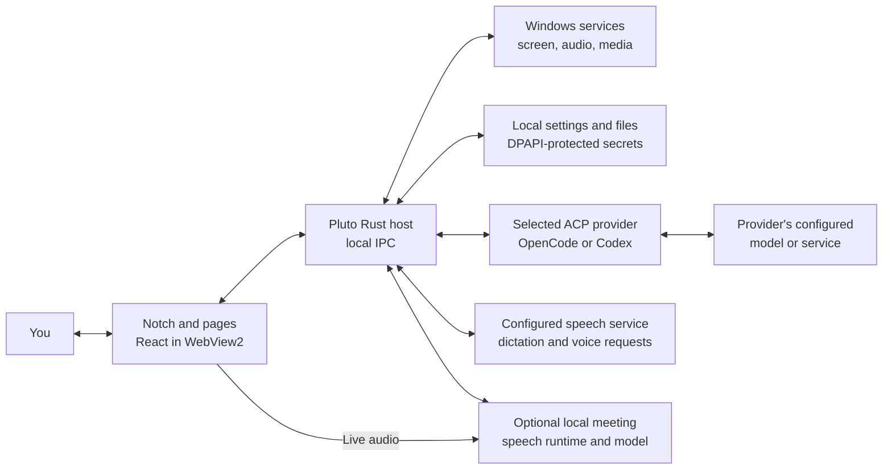
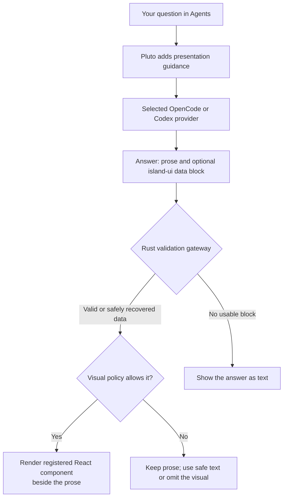

<div align="center">
  

  <p><strong>A compact Windows workspace for notes, useful tools, and AI conversations.</strong></p>

  <p>
    <a href="https://github.com/amxcodes/little-world-pluto/actions/workflows/ci.yml"></a>
    <a href="https://github.com/amxcodes/little-world-pluto/actions/workflows/security-audit.yml"></a>
    <a href="https://github.com/amxcodes/little-world-pluto/actions/workflows/release-windows.yml"></a>
    <a href="LICENSE"></a>
    
  </p>
</div>

## What is Pluto?

Little World Pluto keeps everyday tools and AI conversations close at hand in a small desktop workspace. The notch stays compact until you open it, then expands into pages for quick actions and longer work. It is an early alpha for Windows; features and setup may change as the project develops.

### What you can do

| Area | What it does |
| --- | --- |
| Home and status | Shows media, volume, quick actions, the Shelf, and compact activity such as microphone and camera use. |
| Everyday tools | Keeps text, image, and audio clipboard history; captures the screen; reads OCR and QR codes; picks colors; converts files; shows weather and system controls. |
| Notes and Expand | Saves notes and reminders, and inserts saved text when you type a shortcut. |
| Meetings | Transcribes microphone and/or system audio locally into a saved, source-labeled transcript. Install the separate speech runtime and model on demand in Settings; the runtime stops when recording ends. |
| Agents and Ask | Runs tasks through your configured OpenCode or Codex ACP provider. Answers can include Pluto's built-in visual components; Ask and wake answers stay focused on spoken or plain-text replies. |
| Appearance | Offers light and dark themes, accent colors, media-card layouts, and optional Liquid Glass styling. |

Features that need a provider, model, permission, or optional tool are configured in Settings. Pluto does not bundle OpenCode, Codex, FFmpeg, or the meeting speech model.

## Get started

### Install a release

Download `Pluto-Setup-vX.Y.Z-windows-x64.exe` from [GitHub Releases](https://github.com/amxcodes/little-world-pluto/releases) and run it for your Windows user account. Setup supports upgrades through the same installer. In Settings → General → Updates, you can check for later signed releases and choose when to install one. Releases use a self-signed certificate, so Windows may still show a publisher or reputation warning; see the [release guide](docs/RELEASING.md).

### Run from source

You’ll need Windows 10 or 11 (x64), the WebView2 Runtime, Rust from [`rust-toolchain.toml`](rust-toolchain.toml), Node.js 22 or newer, and npm.

In PowerShell, from the repository folder:

```powershell
cd island-ui
npm ci
npm run build
cd ..
cargo run --locked --release --features product-app --bin pluto
```

To build the executable without launching it, replace the last command with:

```powershell
cargo build --locked --release --features product-app --bin pluto
```

The executable is `target\release\pluto.exe`. OpenCode or Codex must be installed and configured separately. FFmpeg is optional. See [Dependencies](DEPENDENCIES.md) for details.

## How Pluto fits together



Agents and Ask requests use the selected ACP provider; the provider chooses its configured model and service. Dictation and voice requests use Pluto's configured speech endpoint, while wake phrase matching uses Windows speech recognition. For meetings, WebView captures microphone audio, Windows supplies system loopback audio, and the Rust host starts the separate local transcription runtime and stores the returned transcript. Audio or prompts can leave your PC when you use configured external services; see [Privacy and data handling](docs/PRIVACY.md).

## How Agents turns an answer into a visual

Pluto's answer visuals are built-in UI components, not a separate OpenUI server. The selected agent normally writes Markdown. When a diagram or structured view would help, it may add one fenced `island-ui` JSON block describing *data* for a known component, such as a system map, timeline, comparison, chart, or checklist. The app supplies the layout, colors, and interaction.



The gateway accepts version 1, typed data only: at most **32,000 bytes per block**, **24 top-level elements**, **36 total nodes**, **3 nesting levels**, and **4,000 bytes per text field** (often less for labels). It checks each component's fields and numeric ranges. It does not accept provider-supplied HTML, CSS, JavaScript, arbitrary actions, or remote assets. If one component is invalid, the host may keep valid siblings; if no usable presentation remains, the block stays in the text answer. A second policy respects text-only requests, avoids unsupported or misleading subjects, and permits whiteboard sketches only when **Whiteboard explainers** is enabled in Agents settings. The contract lives in [`app/agent_presentation.rs`](app/agent_presentation.rs); the registered renderer lives in [`island-ui/src/agent-presentation.jsx`](island-ui/src/agent-presentation.jsx).

## Project notes

- Windows x64 is the current alpha target.
- OpenCode, Codex, and FFmpeg are separate programs; Pluto does not bundle them.
- Settings and saved files are stored outside the install directory under `%LOCALAPPDATA%\Pluto` and survive upgrades.
- Developer probes used for Windows profiling and packaging checks live in [`probes/`](probes/); they are not user-facing examples.

Pluto is licensed under the [MIT License](LICENSE). Third-party notices are in [`island-ui/THIRD_PARTY_NOTICES.md`](island-ui/THIRD_PARTY_NOTICES.md).

Windows release signing, provenance verification, dependency audits, and Defender response steps are documented in the [release guide](docs/RELEASING.md).
