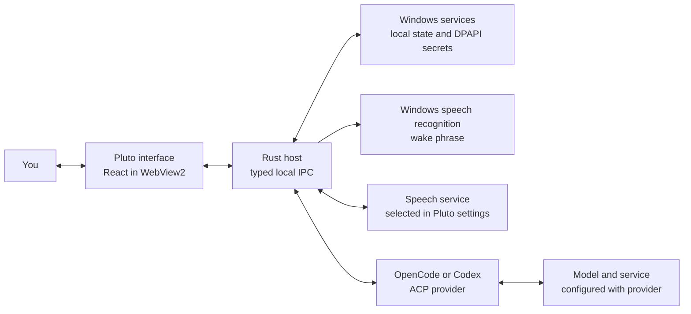

<div align="center">
  

  <p><strong>A compact Windows workspace for notes, useful tools, and AI conversations.</strong></p>

  <p>
    <a href="https://github.com/amxcodes/little-world-pluto/actions/workflows/ci.yml"></a>
    <a href="https://github.com/amxcodes/little-world-pluto/actions/workflows/security-audit.yml"></a>
    <a href="https://github.com/amxcodes/little-world-pluto/actions/workflows/release-windows.yml"></a>
    <a href="LICENSE"></a>
    
  </p>
</div>

## What is Pluto?

Little World Pluto keeps everyday tools and AI conversations close at hand in a small desktop workspace. It is an early alpha for Windows; features and setup may change as the project develops.

## Get started

### Install a release

Download the signed `Pluto-Setup-vX.Y.Z-windows-x64.exe` from [GitHub Releases](https://github.com/amxcodes/little-world-pluto/releases) and run it for your Windows user account. Setup uses Pluto's transparent logo and supports upgrades through the same installer. In Settings → General → Updates, you can check for later signed releases and choose when to install one.

### Run from source

You’ll need Windows 10 or 11 (x64), the WebView2 Runtime, Rust from [`rust-toolchain.toml`](rust-toolchain.toml), Node.js 22 or newer, and npm.

In PowerShell, from the repository folder:

```powershell
cd island-ui
npm ci
npm run build
cd ..
cargo run --locked --release --features product-app --bin pluto
```

To build the executable without launching it, replace the last command with:

```powershell
cargo build --locked --release --features product-app --bin pluto
```

The executable is `target\release\pluto.exe`. OpenCode or Codex must be installed and configured separately. FFmpeg is optional. See [Dependencies](DEPENDENCIES.md) for details.

## How AI works



Text and voice requests go to the selected OpenCode or Codex provider. Transcription uses the speech service selected in Pluto. Wake phrase matching uses Windows speech recognition. Audio and prompts can leave your PC when these services are used; read the [privacy notes](docs/PRIVACY.md).

## Project notes

- Windows x64 is the current alpha target.
- OpenCode, Codex, and FFmpeg are separate programs; Pluto does not bundle them.
- Settings and saved files are stored outside the install directory under `%LOCALAPPDATA%\Pluto` and survive upgrades.
- Developer probes used for Windows profiling and packaging checks live in [`probes/`](probes/); they are not user-facing examples.

Pluto is licensed under the [MIT License](LICENSE). Third-party notices are in [`island-ui/THIRD_PARTY_NOTICES.md`](island-ui/THIRD_PARTY_NOTICES.md).

Windows release signing, provenance verification, dependency audits, and Defender response steps are documented in the [release guide](docs/RELEASING.md).
