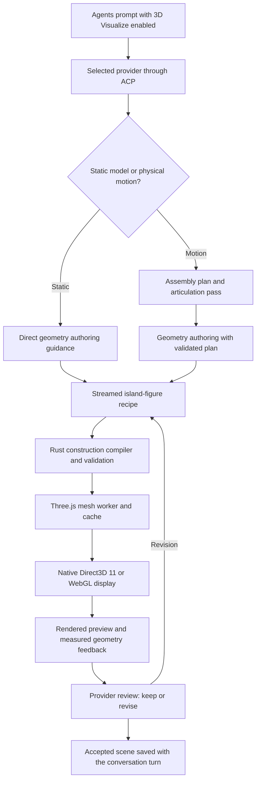

# Pluto's current 3D pipeline

Inspected 7 November 2026. This document describes the existing implementation;
the Liquid Mode work did not change its authoring, planning, validation,
geometry, animation or rendering code.

## The flow

## 1. The selected model authors the scene

The Agents UI exposes the visualization toggle for supported model families.
When enabled it marks the task as a 3D visualization request. Rust's ACP worker
communicates with the selected Codex or OpenCode harness using requests such as
`session/prompt`. ACP is the communication protocol; the selected language model
is responsible for choosing the object structure, proportions and details.

Ask and wake conversations use their own surfaces and instructions. Their
spoken-answer path does not receive the Agents 3D authoring instructions.

Sources: `island-ui/src/agents-ui.jsx`, `app/agent_acp.rs`.

## 2. Static modeling and motion have different authoring paths

A static model uses the direct geometry-authoring guidance. It does not first
freeze its shape into the separate assembly planner's layout.

Physical animations and transformations use an internal ACP planning session
for applicable Agents requests. The plan describes forms, parent groups,
physical components, local coordinate frames and identifying details. A second
articulation pass refines moving groups' pivots, axes, translation/rotation
tracks, dependencies and shared timing. When a source model already exists,
its saved frames and identities are used as the starting assembly.

The host checks the structured plan, including references to parts, hierarchy,
timing and declared endpoint landmarks. These are concrete data checks; the
model still supplies the intended mechanism and shape.

Sources: `app/figure_design.rs`, `app/figure_static_guidance.txt`,
`skills/pluto-3d-authoring/SKILL.md`, `app/agent_acp.rs`.

## 3. The model emits a recipe, not arbitrary executable JavaScript

The answer contains a fenced `island-figure` construction program: a JSON header
followed by complete JSON records for groups, parts, placement and motion.
The Rust construction compiler expands supported recipes and checks IDs,
parents, geometry values, limits and motion contracts before producing the
presentation data. Complete streamed records can produce a progressive preview;
an incomplete preview is distinguished from a completed scene.

Sources: `app/figure_program.rs`, `app/agent_presentation.rs`.

## 4. A worker turns recipes into meshes

The Three.js worker builds actual vertices, normals and triangle indices from
the supported shapes: rounded primitives, extrusions, revolved profiles, tubes,
gears, springs, surfaces and organic shapes, among others. A cache reuses
unchanged geometry. Work runs outside the UI thread, and completed parts return
incrementally to the viewer.

Sources: `island-ui/src/figure-worker.js`,
`island-ui/src/agent-figure-scene.jsx`, `island-ui/src/scene-build-queue.js`.

## 5. A shared scene graph keeps moving details attached

Each child is placed in its parent's local coordinate system. Its world pose
combines its local transform with its ancestors' transforms. Moving a carrier
therefore also moves its child details. The animation evaluator interpolates
tracks on a shared clock, with supported cycles and bounded frame controls.
Mouse interaction controls the camera and can pause playback.

On Windows the default display uses a native Direct3D 11 / DirectComposition
overlay. The Three.js WebGL renderer is the fallback. They consume the same
constructed mesh and scene information; the native overlay is not Clicky's
engine. Three.js is both the geometry library and the WebGL rendering library.

Sources: `island-ui/src/figure-motion.js`,
`island-ui/src/agent-figure-display.jsx`, `island-ui/src/agent-scene-viewer.js`,
`island-ui/src/native-figure-overlay.js`, `app/platform/windows/figure_overlay.rs`,
`app/platform/windows/figure_pose.rs`, `app/platform/windows/figure_clock.rs`.

## 6. Review uses the result that actually rendered

The viewer reports geometry/build failures and measured bounds/contact
information. It can generate multi-view previews, including start, middle and
end poses for staged motion. When the provider supports image inputs, the
review can receive those images and available reference images. Otherwise it
uses the recipe and structural diagnostics without claiming a visual comparison.

The review can keep a satisfactory scene or return a complete revision. Recovery
is bounded, rejected candidates are checked, and usable earlier geometry is
retained where appropriate. These checks are not a complete physics simulation
or a guarantee of real-world mechanical correctness.

Sources: `app/agent_acp.rs`, `app/figure_design.rs`,
`island-ui/src/agent-figure-scene.jsx`, `island-ui/src/agent-scene-viewer.js`.

## 7. A follow-up edits the same saved scene

The local SQLite store saves prompts, answers and presentation JSON by provider,
conversation surface and turn. A model-edit follow-up supplies the existing
scene to the provider and preserves stable IDs, parent links and unaffected
geometry. That is what lets a later motion request extend the model already
created in the conversation, instead of starting from an unrelated object.

Sources: `app/agent_sessions.rs`, `app/agent_acp.rs`.
