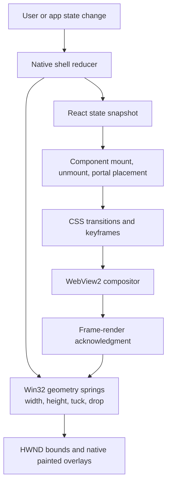

# Pluto animation audit

## Wake motion follow-up — 2026-10-23

Source review only, as requested. Existing React/WebView2 design and native geometry springs are retained. No visual, microphone, GPU or monitor testing was performed.

| Finding rechecked | Change / disposition |
|---|---|
| Wake inherits Settings geometry | Confirmed: a trigger now clears the Settings height override, and wake geometry takes precedence during opening and retained dismissal. React closes Settings in a layout effect before paint. |
| Listening grows again after opening | Confirmed: the old 90px content preference also received 24px React padding and 32px native inset. Listening now advertises 34px, yielding the intended 90px total. Capture errors explicitly request more room and remain scrollable. |
| Old Agents layout reaches a new wake cycle | Confirmed: layout messages now identify the wake surface and revision; native rejects measurements from a different surface/cycle. |
| Listening to thinking expands before an answer exists | Confirmed: listening and thinking retain the compact footprint until text, approval, or an error needs the answer surface. Shared eyes react to actual microphone levels; thinking uses a restrained opacity pulse. Reduced motion disables the pulse. |
| Text restarts or jumps during streaming | Removed session-ID dependence from answer/line keys; the existing question generation owns replay. Disabled scroll anchoring in the answer scroller, kept the stable scrollbar gutter, and strip inline emphasis delimiters consistently even before the closing delimiter arrives. Completed line animations release their blur effect instead of retaining it via forwards fill. Natural word wrapping remains. |
| Overlapping capture and shell movement | Wake capture uses opacity only; native springs own positional expansion. Ask's existing capture styling is preserved. |
| Media picker close lifecycle | CSS animation completion now removes the panel, filtered to its own exit event. A 300ms fallback handles cancelled/missing events; normal CSS exit remains 180ms. Reopening cancels the fallback. |
| Calendar exits, media-style transitions, session selection | Retained pending reproduction: adding exit state or changing selection ordering is not justified by differing durations alone. |
| External drag native/React ownership, occlusion recovery, full-window uploads, blur cost, mixed-DPI placement | Still deferred: source review alone does not establish the active runtime path or performance cost. No speculative rewrites or dependency changes. |

Validation: all 24 frontend tests pass, production UI bundle builds, and `cargo check --offline --locked --features product-app --bin pluto` passes. Regression coverage includes first-render listening and thinking, exact compact height including insets, capture-error height, revision metadata, and ignored descendant streaming mutations. `cargo fmt --all -- --check` reports only an existing formatting difference in `app/opencode_control.rs`; this unrelated file was left unchanged. These are correctness checks, not measured frame-rate or memory improvements.

## Implementation follow-up — 2026-10-22

The original source audit below is retained as a baseline; its line anchors refer to the pre-change code. This follow-up records the subsequent implementation pass. React/WebView2 remains the UI, with existing colors, geometry, controls, spring profiles, and line-reveal timing preserved. No dependencies were added.

| Audit item | Disposition |
|---|---|
| Ask hold state leaking into Home Dictate | Fixed: Home entry and transcript consumption reset hold ownership and release state. |
| Ask handlers rebinding on agent snapshots | Fixed: stable listeners read current capture eligibility from a ref; owned releases survive a focus change to an editor, blur, and route teardown. |
| Initial wake view reporting answer height before capture begins | Fixed: a pending trigger renders the capture branch and advertises 90px on the first React render. |
| Escape/silence leaving an expanded wake surface | Fixed: capture cancellation uses the same retained native close path as outside-click dismissal. Width is held through the exit. |
| Old wake completion rearming a newer capture | Fixed: pending completion is scoped to provider, wake revision, and the accepted operation revision. Dismissal invalidates pending wake work; native resume also rejects stale revisions. |
| Repeated replies reusing line nodes and scroll position | Fixed: each submitted voice/Ask question gets a stable answer generation. The answer scroller remounts once per question; streaming chunks retain the same nodes. |
| Nested wake opacity animations | Fixed: removed the redundant parent answer fade; the existing line blur/fade owns text reveal. |
| Settings section changes remounting form state | Fixed: section selection no longer keys the whole page boundary. Only the section scroller remounts, restoring its saved position and using the existing section fade. |
| Settings return/timer/focus behavior | Fixed: return content uses the existing page entrance; route exits cancel the pending close timer. Back returns focus to Settings with scroll preserved. |
| Conversion old-row replay and overlapping row/icon transforms | Fixed: persistent row IDs retain their arrival delay; new batches start their own stagger at zero. Removed superseded motion rules and the second icon transform. Source preview is keyed to the handoff ID, replacing the 900ms reset timer. |
| Media clock rerendering the app root | Fixed: playback interpolation and seek state now live in a React `MediaTransport` subtree. Its 250ms clock runs only while that subtree is mounted, playing, and document-visible. Unrelated state snapshots no longer reset playback's receipt timestamp. |
| Agent snapshots recreating layout observers | Fixed: retained observers follow root replacement and `data-layout-height` changes. Broad `state.agents` identity is no longer a sizing-effect dependency. |
| Shelf lost pointer capture | Fixed: loss of capture uses the existing cancellation handler. |
| Delayed focus restore racing Alt+Tab | Fixed: restoration exits if another external window already has foreground ownership. |
| OS/app reduced-motion mismatch | Fixed: native geometry combines the saved app preference with Windows client-area animation settings, including live `WM_SETTINGCHANGE`; the effective OS value is also sent to React. The saved app setting remains independently editable. |
| Wake dismissal flashing the normal Agents page | Already guarded: source inspection confirmed the bridge reports `wake_surface || wake_closing`, retaining the wake view during native exit. |
| Wake transcription error recovery UI | Deferred: the existing error text and outside-click recovery remain. A new retry control would require a visual/product decision; capture cancellation is now handled. |
| Media picker 180/220ms timing, media style switching, calendar exit, session-selection flash | Deferred pending reproduction. These timing differences or missing transitions alone do not establish a visible defect. |
| Native/React external-drag overlap and expanded drop-preview styling | Deferred pending native interaction capture; no target ownership or drop registration was changed without verifying the actual active path. |
| WebView occlusion/resume handshake | Existing generation acknowledgment and 750ms recovery retained. Requires real WebView2 visibility testing. |
| Waveform update frequency, clipboard derivation, conversion filtering | Retained: bounded/local work has no measured performance problem. Conversion's seen-item cache now prunes removed IDs. |
| Full-surface native uploads, blur/GPU cost, monitor placement policy | Deferred: hardware profiling and multi-monitor testing are required. Primary-display placement and existing native springs remain intact. |

Validation: frontend regressions exercise capture cleanup, keyboard ownership, stale wake completion, answer identity, first-frame wake sizing, timer cleanup, and preferred-height observation. A synthetic observer scenario with 100 descendant changes schedules no extra layout reports; a preferred-height change schedules one report. This validates event ownership, not a frame-rate or CPU/memory benchmark.

The frontend suite, production frontend bundle, Rust shared-core tests, architecture-boundary check, and product compilation are checked during this pass. Strict product Clippy reports 81 findings across existing product code (including untouched ACP, capture, wake-word, and storage code). The broader product test target is blocked by nine unresolved references in existing `app/commands.rs` and `app/platform/windows/tray.rs` tests. Those unrelated files were not modified. Live browser preview was attempted, but the browser tool could not reach the localhost preview server; no native visual, microphone, GPU, mixed-DPI, or end-to-end timing result is claimed.

## Original audit

**Date:** 2026-10-22  
**Scope:** Read-only review of animation behavior, ownership, interruption paths, component overlap, reduced-motion handling, and likely performance risks across the Windows shell and React UI.  
**Limits:** This is a source audit. The app was not launched, and no screen recording, frame-time trace, GPU profile, or automated visual test was collected. Findings marked *confirmed* describe source behavior; visual impact and timing artifacts marked *verify* need runtime confirmation. No animation implementation was changed.

## Summary

Motion is implemented in three layers: native Win32 window geometry, React state handoffs and component lifecycle, and CSS transitions/keyframes. The native shell uses retargetable springs and deliberately coordinates compact-state handoff with a rendered-frame acknowledgment. The UI has motion families for navigation, overlays, media, settings, voice, reminders, conversion, agents, and whiteboard visuals. Most families have reduced-motion handling.

The main risks are coordination between those layers, broad React state invalidation, and a growing, fragmented set of CSS overrides. The wake path is wired through listening, transcription, thinking, answer, re-arm, and dismissal; the clearest timing concern is native resizing from the 90px capture layout to the 330px answer layout while parent and per-line answer reveals run together. Other source-confirmed findings include the abrupt Settings return, unused section entrance, repeated Ask lines reusing animated nodes, queue-wide conversion arrivals, an Ask hold-capture state that can leak into Home Dictate, and media/agent state updates that can trigger wider React work than their visible controls need. Their code paths are clear; performance and visual impact are unmeasured. The detailed wake trace, architecture review, and confidence labels follow below.

## Motion ownership map

The native shell and WebView do not share one timeline. The shell animates dimensions; React may simultaneously animate opacity, transform, and blur, or mount new content. A compact-state handoff waits for WebView frames before shrinking, which is a useful explicit synchronization point. Other transitions rely on independent timers and CSS durations.

## Inventory by surface

| Surface | Trigger and motion | Ownership and source | Collision or interruption review |
|---|---|---|---|
| Shell open, close, resize, tuck | Width/height, compact-status, in-place, open, and collapse spring profiles. Retargeting preserves or discards velocity according to direction; reduced motion snaps values. | Native `SpringMotion` plus shell scheduler: [motion.rs](../src/motion.rs#L21), [shell.rs](../app/platform/windows/shell.rs#L223), [shell.rs](../app/platform/windows/shell.rs#L8272). | Retarget/reset logic is designed to avoid stale first-frame jumps. Verify rapid open→close→open, hover/tuck, pinning, and resize retargets at high refresh and display scaling. |
| Compact status and context tools | Status identity changes crossfade old/new content over 260 ms. Context rail uses hover dwell, enter/leave delay, and a short leave/unmount window; shell width is adjusted for active privacy indicators. | React identity/lifecycle and CSS, with native width: [main.jsx](../island-ui/src/main.jsx#L424), [style.css](../island-ui/src/style.css#L762), [shell.rs](../app/platform/windows/shell.rs#L4047). | Continuous media metadata changes intentionally do not restart status animation. Validate source changes separately from ordinary title/position updates. Test rapid pointer reversal and microphone/camera indicator changes while the rail is entering or leaving. |
| Drag targets and conversion handoff | Native drag polling and target spring; React drop state; conversion source, queue row, icon, and connector animations. Batch rows are staggered. | Native shell and React/CSS: [shell.rs](../app/platform/windows/shell.rs#L7876), [conversion-ui.jsx](../island-ui/src/conversion-ui.jsx#L54), [conversion.css](../island-ui/src/conversion.css#L207). | Native and React both describe drop targets in different shell states. Confirm no duplicate/covered target during HWND handoff. Test cancel, left/right retarget, cursor drift after release, and a second batch arriving before the first 900 ms handoff timer completes. |
| Main page navigation | Page content is keyed by active page and enters with a short 115 ms opacity animation; active tab pill uses an independent JS spring. | React key and CSS/RAF: [main.jsx](../island-ui/src/main.jsx#L2800), [style.css](../island-ui/src/style.css#L967), [main.jsx](../island-ui/src/main.jsx#L2699). | Content and nav pill move independently. Verify quick multi-page clicks, when the native shell is also resizing, and after returning from nested pages. |
| Settings | Entry (230 ms), exit (170 ms), and nav return (180 ms); disclosures reveal in 160 ms. Sections are keyed/remounted. | React timer/state and CSS keyframes: [main.jsx](../island-ui/src/main.jsx#L1993), [settings.css](../island-ui/src/settings.css#L8), [main.jsx](../island-ui/src/main.jsx#L2800). | See confirmed findings below. Also test section switching while scrolled, keyboard focus, and a narrow settings viewport. |
| Media source picker and cards | Picker enters/exits separately from the underlying media card’s opacity/position/blur transition. Card variants alter layout; backdrop art is blurred. | CSS and React state: [style.css](../island-ui/src/style.css#L69), [style.css](../island-ui/src/style.css#L1626), [style.css](../island-ui/src/style.css#L1668). | Picker exit is 180 ms while the card restoration transition is 220 ms. A 40 ms mismatch exists in source timing; whether it is perceptible needs runtime review. Art blur may add GPU cost on integrated graphics/high DPI. |
| Ask, wake answer, and dictation | Ask lines stagger by 45 ms (capped after six); wake answer fades in; thinking dots pulse; wake eyes/audio bars respond to input; dictation portal moves between content slots. | React line keys/portals and CSS: [agents-ui.jsx](../island-ui/src/agents-ui.jsx#L801), [agents-ui.jsx](../island-ui/src/agents-ui.jsx#L818), [style.css](../island-ui/src/style.css#L2591), [main.jsx](../island-ui/src/main.jsx#L2011). | Ask line keys are based on session and line index; replacing answer text at the same indexes may reuse nodes, preventing entrance animation replay. Wake answer height change and line reveal can coincide with native resize. Verify hold/release during microphone startup and repeated questions. |
| Notes and reminders | Calendar entrance, keyed month slide/fade, keyed hour/minute roll, and reminder/time controls. | CSS and React keys: [style.css](../island-ui/src/style.css#L1825), [style.css](../island-ui/src/style.css#L1837), [settings.css](../island-ui/src/settings.css#L152), [main.jsx](../island-ui/src/main.jsx#L1114). | Fast month navigation restarts the entrance. Check focus after month change and rapid time-step input while the previous digit animation is running. |
| Agents, sessions, approvals, visuals, whiteboard | Workspace/session/results enter; selected visual elements and SVG paths transition or animate; whiteboard itself is mostly static geometry/state changes. | CSS and React component state: [style.css](../island-ui/src/style.css#L405), [style.css](../island-ui/src/style.css#L436), [style.css](../island-ui/src/style.css#L534), [style.css](../island-ui/src/style.css#L566). | Rapid session/task changes can restart entrances while workspace layout changes. Test pending approvals and streaming responses during tab switches. No whiteboard stroke-draw sequence was found in the inspected rules. |
| Capture / screen selection | Native selection overlay paints immediately; no explicit enter/exit motion was found in the inspected path. | Win32 overlay: [screen_overlay.rs](../app/platform/windows/screen_overlay.rs#L316), [screen_overlay.rs](../app/platform/windows/screen_overlay.rs#L1535). | Treat as intentionally immediate unless product behavior expects motion. Test cancellation/selection during shell collapse and focus restoration. |
| Dictation, signature, weather, command, and utility panels | Small component entrances, waveform transitions, weather refresh fade, and command panel entrance; signature is pointer-rendered rather than animated. | CSS/React: [style.css](../island-ui/src/style.css#L1783), [style.css](../island-ui/src/style.css#L1955), [style.css](../island-ui/src/style.css#L1979), [style.css](../island-ui/src/style.css#L2550). | These are mostly local transitions. Check page replacement/dismissal while recording and weather refresh while the layout is changing. |

## Findings

## Wake mode: source-derived state trace

This is the complete wake-answer path reconstructed from the native shell, React state, and CSS. It is not a visual test.

| Stage | Code path and rendered change | Motion interaction / likely failure mode |
|---|---|---|
| 1. Armed listener | Wake service reports `listening`; a phrase match changes native status to `triggered`. The shell marks the wake surface active, sets width to 480 and initial content height to 90, selects Agents, and opens the shell: [shell.rs](../app/platform/windows/shell.rs#L6630), [shell.rs](../app/platform/windows/shell.rs#L6647). | Native open spring starts while React changes page and voice-surface class. This phase has no dedicated answer surface yet. |
| 2. Listening surface | The React workspace observes the new revision, snapshots the selected provider/session, switches to task view, and requests auto-submit dictation: [agents-ui.jsx](../island-ui/src/agents-ui.jsx#L504). The compact DictatePanel auto-starts capture when configured; `minimal` renders the eyes/audio level surface. The parent reports a 90px preferred height: [main.jsx](../island-ui/src/main.jsx#L1682), [main.jsx](../island-ui/src/main.jsx#L1749), [agents-ui.jsx](../island-ui/src/agents-ui.jsx#L809). | Parent shell opening, component entrance, audio-level transitions, and the native microphone-ready beep are separate events. The actual listening transition waits for `MediaRecorder.onstart`, not just the Space/wake trigger. |
| 3. Capture stop | Auto-submit VAD stops after the configured quiet interval, or recording ends on limit/error. Stopping finalizes the blob and changes the panel from recording to transcription: [main.jsx](../island-ui/src/main.jsx#L1537), [main.jsx](../island-ui/src/main.jsx#L1620). | The listening visual can stop before the speech service returns. Check that processing has a stable visible state and that a slow transcription does not look like a dropped capture. |
| 4. Transcription result | A matching request result updates transcript/error. Success calls the portal’s `onInsert`; App closes the dictation portal and passes dictated text to Agents. The pending voice request waits for the target provider/session to be ready before submission: [main.jsx](../island-ui/src/main.jsx#L1590), [main.jsx](../island-ui/src/main.jsx#L2957), [agents-ui.jsx](../island-ui/src/agents-ui.jsx#L482), [agents-ui.jsx](../island-ui/src/agents-ui.jsx#L735). | The visible eyes/listening panel disappears before the answer surface is populated. The same native surface stays open, so there is an intermediate wait that must be represented by the thinking state, not an empty frame. |
| 5. Thinking / provider request | `pendingVoice` is submitted once provider/session readiness permits. ACP marks the session active and replaces the visible response with a fresh `waiting: true` response; `voiceThinking`/`voiceAwaitingText` render the thinking indicator until text arrives: [agents-ui.jsx](../island-ui/src/agents-ui.jsx#L735), [agent_acp.rs](../app/agent_acp.rs#L1773), [agents-ui.jsx](../island-ui/src/agents-ui.jsx#L801). | Thinking is an actual state, not inferred from animation timing. When the first response text arrives, the indicator is replaced with answer lines and the container can change height/content immediately. |
| 6. Answer reveal | With capture removed, the surface reports 330px preferred height. The answer text fades for 320ms; each line also receives a 300ms blur/fade, staggered by up to 270ms: [agents-ui.jsx](../island-ui/src/agents-ui.jsx#L809), [agents-ui.jsx](../island-ui/src/agents-ui.jsx#L818), [style.css](../island-ui/src/style.css#L2598), [style.css](../island-ui/src/style.css#L2605). | **Confirmed overlap:** the shell height spring and CSS answer reveal are both active. The last line’s CSS entrance can finish roughly 570ms after the answer subtree mounts. This is a plausible source of perceived late text/position shift; exact visible impact needs a capture. |
| 7. Wake listener resumes | Once the response finishes, Agents sends `wakeWordResume`; native code re-arms the listener while leaving the answer surface present: [agents-ui.jsx](../island-ui/src/agents-ui.jsx#L744), [shell.rs](../app/platform/windows/shell.rs#L4234). | Answer remains visible while mic detection resumes. A retrigger replaces the answer with the capture portal and requests the 90px layout again. This can reverse the shell spring while answer lines or scrolling are still active. |
| 8. Dismiss | Outside click dispatches the voice-dismiss event, sets `wake_surface=false`, holds `wake_closing=true`, and closes the shell. Native shell retains the wake width until React is no longer visible, then resets width: [shell.rs](../app/platform/windows/shell.rs#L7667), [shell.rs](../app/platform/windows/shell.rs#L8232). | This is a two-owner exit: React removes the portal and native geometry closes. Verify that answer/voice content does not flash back to Agents during the collapse, and that a rapid retrigger cancels the old close state. |

### Wake-specific conclusions

- **The intended sequence exists in code:** trigger → minimal listening → transcription → thinking → answer → re-arm → outside-click dismissal. There is a real thinking state and a separate answer layout.
- **The strongest animation coordination risk is answer entry plus shell resize.** The capture state advertises 90px, then text state advertises 330px at the same time as the 320ms parent fade and line-level stagger. Native shell and CSS do not share a completion signal for this expanded-state transition.
- **Answer entrance is nested.** Parent opacity begins on answer mount, while each child line also fades/defocuses. This means the first line is affected by both opacity animations; later lines start after their stagger. That can read as a prolonged reveal, especially for a long response.
- **First-token replacement can shift content.** Thinking is a 33px-minimum row; answer paragraphs have their own line height/margins and the scroll container has max-height rather than a fixed initial block height. Replacing the thinking row with streamed text changes intrinsic content height. The outer 330px shell target limits overall size, but the text’s internal position may still move. This is a code-derived risk, not a confirmed visual defect.
- **Transcription failure is an awkward terminal state.** In minimal wake mode, an error is rendered as text next to the eyes, but the minimal branch has no retry or dismiss control. The listener has already been triggered/disarmed; user recovery requires outside dismissal. This is a state-path limitation that can make the listening surface appear stuck, not a visual-collision claim.
- **Retigger during an answer reverses the layout state.** A new trigger changes the surface from answer to capture (330→90), while native motion retargets and previous answer content unmounts. This interruption path is not given an explicit cross-fade/exit sequence in the source.

## Additional state/lifecycle findings

1. **Ask’s hold-capture flag can leak into later Home Dictate.** Ask pointer/Space entry sets `holdCapture`; releasing the capture sets a global released flag. Transcription consumption resets auto-submit but not `holdCapture`; `openDictation` also does not clear it. The next Home Dictate receives `holdCapture=true`, installs release listeners, and can stop immediately after `MediaRecorder.start()` because the old global release flag is still true. This exact state flow is confirmed in source; the user-visible result is inferred. Evidence: [main.jsx](../island-ui/src/main.jsx#L2031), [main.jsx](../island-ui/src/main.jsx#L1693), [main.jsx](../island-ui/src/main.jsx#L1707), [main.jsx](../island-ui/src/main.jsx#L2308), [main.jsx](../island-ui/src/main.jsx#L2957), [agents-ui.jsx](../island-ui/src/agents-ui.jsx#L482), [main.jsx](../island-ui/src/main.jsx#L2896).

2. **Repeated Ask answers reuse line nodes and keep the prior scroll offset.** The answer container uses a stable `answer` key and each child line is keyed by session ID and line index. New text in the same session therefore reuses existing line nodes, so CSS mount animations do not replay for reused indexes. No scroll reset is tied to a new response. This is confirmed React key behavior; whether the scroll offset is visibly wrong depends on the previous answer length. Evidence: [agents-ui.jsx](../island-ui/src/agents-ui.jsx#L818), [style.css](../island-ui/src/style.css#L2591).

3. **Conversion queue arrival animation is queue-wide rather than new-file-only.** The 900ms handoff state applies a workspace class; its selector matches all queue rows, and stagger is based on each row’s absolute queue index. On later drops, old rows may replay or delay new rows. A second drop during the active class does not toggle the class, so the source preview does not restart; after the timer clears, a new drop replays the queue. Confirmed selectors/timer; appearance needs runtime review. Evidence: [conversion-ui.jsx](../island-ui/src/conversion-ui.jsx#L54), [conversion-ui.jsx](../island-ui/src/conversion-ui.jsx#L76), [conversion-ui.jsx](../island-ui/src/conversion-ui.jsx#L110), [conversion.css](../island-ui/src/conversion.css#L232).

4. **Settings section change remounts the panel, including local form state.** The subtree key contains section and overlay flags. Section switching immediately remounts `SettingsPanel`; the section animation is unused, and fields held in local React state can reset if their values were not committed before unmount. This is a lifecycle side effect of the transition structure, not solely an animation issue. Evidence: [main.jsx](../island-ui/src/main.jsx#L1202), [main.jsx](../island-ui/src/main.jsx#L1311), [main.jsx](../island-ui/src/main.jsx#L2800), [style.css](../island-ui/src/style.css#L2190).

5. **Routes can bypass Settings exit and leave a delayed timer active.** Navigation, command opening, or a wake trigger can set Settings closed directly rather than going through `closeSettingsWithMotion`. If that happens during the 170ms Back timer, that timer can later set `settingsReturning` and animate the nav after the route changed. Source confirms the unsynchronized timer; visible impact is timing-dependent. Evidence: [main.jsx](../island-ui/src/main.jsx#L1993), [main.jsx](../island-ui/src/main.jsx#L1980), [main.jsx](../island-ui/src/main.jsx#L2213), [main.jsx](../island-ui/src/main.jsx#L2306).

6. **Note/reminder calendar has an entrance but no retained exit state.** Calendar/reminder branches unmount directly when closed or saved; only the enter keyframes exist. This differs from top-level page transitions, which at least fade the newly keyed page. Evidence: [main.jsx](../island-ui/src/main.jsx#L2898), [style.css](../island-ui/src/style.css#L1825).

7. **Agent session switching can briefly render the old response.** The click sends a new selection and changes view before the next native snapshot arrives; response/session are derived from the old snapshot in that interval. This is a bridge timing risk, not proof of a visible flash. Evidence: [agents-ui.jsx](../island-ui/src/agents-ui.jsx#L701), [agents-ui.jsx](../island-ui/src/agents-ui.jsx#L515).

8. **Media style changes do not have a dedicated shared layout transition.** Standard/backdrop/studio mode changes alter class-dependent geometry; no general transition covers the full card layout. This can cause a snap when the setting changes. Evidence: [main.jsx](../island-ui/src/main.jsx#L2805), [style.css](../island-ui/src/style.css#L1673), [style.css](../island-ui/src/style.css#L1683).

### Remaining items requiring visual confirmation

The following are code-derived collision candidates, not confirmed defects:

1. **Conversion row and file icon both animate transforms.** This can produce intentional layered movement or a file that appears to jump relative to its row. Check one-file and batch drops, including rapid cancel/re-add. Evidence: [conversion.css](../island-ui/src/conversion.css#L211), [conversion.css](../island-ui/src/conversion.css#L232).

2. **Media picker and card restoration durations differ.** Picker exit is 180 ms; the underlying card restoration takes 220 ms. Check whether the final 40ms looks like an unfinished reveal, especially while metadata/artwork changes. Evidence: [style.css](../island-ui/src/style.css#L69), [style.css](../island-ui/src/style.css#L1634).

3. **Native and React drop-target ownership may overlap during handoff.** Conditions differ between native-painted and React targets; no runtime overlap was established. Check release with cursor drift, cancellation, retargeting, and repeated drag entry. Evidence: [shell.rs](../app/platform/windows/shell.rs#L7876), [main.jsx](../island-ui/src/main.jsx#L2799).

4. **Blur/backdrop filters may cost more on lower-end graphics.** Context rail and media artwork animate blur. This is a plausible compositor/GPU cost, not a measured regression. Profile integrated graphics at high display scale before optimizing. Evidence: [style.css](../island-ui/src/style.css#L793), [style.css](../island-ui/src/style.css#L1668).

5. **Focus and scroll continuity must be checked alongside motion.** Settings open/close, calendar month changes, and Ask answer replacement change or remount focused/scrolling content. Verify the post-transition target and scroll position.

## Architecture, performance, and Windows behavior review

This section broadens the motion audit to the UI state and rendering architecture that drives motion. It is still source-only: cost and visible symptoms marked *likely* have not been measured on a running build. Recommendations describe safer future directions, not changes made in this audit.

### Prioritized findings

| Priority | Finding and evidence | Why it matters | Better direction that preserves the current visual quality |
|---|---|---|---|
| P1 · profile first | **A 250 ms media clock can rerender the full React root.** The timer is active while the island is expanded on Home, and its position value feeds playback timestamps and seek controls: [main.jsx](../island-ui/src/main.jsx#L2297), [main.jsx](../island-ui/src/main.jsx#L2658), [main.jsx](../island-ui/src/main.jsx#L2815). | The update cadence is confirmed; the cost on slower systems is not. A root render can reconcile unrelated visible UI while the user is interacting with the island. | Keep the clock in a small memoized player/seek subtree, or update a progress element through a ref/CSS variable. Stop or lower the cadence while the player is hidden. Keep the same animation curve and timing. |
| P1 · profile first | **Agent snapshots can repeatedly rebuild the intrinsic-size observer.** The bridge creates new state snapshots, while a layout effect depends on the whole `state.agents` object and forces measurement; measurement reads layout and can send a native layout update: [main.jsx](../island-ui/src/main.jsx#L2172), [main.jsx](../island-ui/src/main.jsx#L2420), [main.jsx](../island-ui/src/main.jsx#L2487). | Streaming state changes can trigger observer teardown/recreation and layout reads even when panel geometry did not change. Jank is plausible, but requires profiling to establish. | Keep one observer mounted and read current values through refs. Measure only when a geometry-relevant version changes; do not tie intrinsic sizing to every streamed agent snapshot. |
| P1 · validate first | **Wake can briefly choose the answer-sized layout before capture starts.** The native trigger sets the 90px listening target, but the first React wake render can still select the 330px answer branch until a passive effect starts dictation; layout observation can run before that effect: [shell.rs](../app/platform/windows/shell.rs#L6647), [agents-ui.jsx](../island-ui/src/agents-ui.jsx#L486), [agents-ui.jsx](../island-ui/src/agents-ui.jsx#L809), [main.jsx](../island-ui/src/main.jsx#L2438). | A transient larger measurement may retarget the shell before the capture view settles. This is a strong source-based timing risk, not a runtime-confirmed jump. | Represent wake as an explicit phase (`listening`, `thinking`, `answer`) in the state bridge and render the target layout from that phase on the first frame. Keep the spring and reveal choreography, but measure a stable phase-specific container. |
| P1 · recoverability | **Wake Escape/no-speech can leave the native 480px surface open after capture UI is removed.** Auto-submit close resumes wake detection but does not dismiss the wake surface; the silence timeout follows the same close path: [main.jsx](../island-ui/src/main.jsx#L1545), [main.jsx](../island-ui/src/main.jsx#L1572), [main.jsx](../island-ui/src/main.jsx#L2957), [shell.rs](../app/platform/windows/shell.rs#L6647). | The captured source path leaves no obvious action in the minimal wake branch. Whether it looks blank depends on the exact rendered state, but it is a state-recovery gap. | Make every wake phase end in a defined visible state: retry, answer/error, or collapse. Tie the native surface lifecycle to the same phase/generation rather than letting a dismissed capture leave an expanded shell. |
| P1 · stale result risk | **Wake completion uses a shared awaiting-answer flag instead of a request identity.** A delayed earlier request can potentially satisfy a later wake cycle after dismissal/retrigger: [agents-ui.jsx](../island-ui/src/agents-ui.jsx#L740), [agents-ui.jsx](../island-ui/src/agents-ui.jsx#L748), [shell.rs](../app/platform/windows/shell.rs#L4234). | With rapid user behavior, a stale completion may resume listening in the wrong cycle. This is an inferred race; verify with two overlapping requests. | Give each capture/request a monotonically increasing generation ID. Accept completion/rearm only when the ID matches the active phase; preserve the current visuals and transition durations. |
| P2 · interaction stability | **Ask’s Space handlers depend on the entire Agents snapshot.** Streaming snapshot identity changes can remove/re-add keyboard listeners during a press-and-hold: [main.jsx](../island-ui/src/main.jsx#L2020). | A rapid keydown/up or focus change during streaming can expose a missed release or duplicate transition. The rebinding is source-confirmed; missed input needs runtime testing. | Keep listeners stable and read the latest capture state from a ref. Track physical key/pointer ownership per capture and always clear it on keyup, pointer cancel, blur, and unmount. |
| P2 · lifecycle | **Keyed page and settings subtrees remount more often than the visible route changes.** Page keys include settings and overlay state; Settings section keys remount the form subtree: [main.jsx](../island-ui/src/main.jsx#L2800), [main.jsx](../island-ui/src/main.jsx#L1311). | This can reset local form drafts, focused controls, and scroll position while also restarting entrances. | Keep stable page identity and animate a presence layer around route content. Use explicit transition state for the few intentional remounts, with scroll/focus restoration as part of navigation. |
| P2 · latency | **Dictation meter updates React state every 80 ms for 25 bars.** The meter is localized, which limits the rerender scope, but still updates at 12.5 Hz: [main.jsx](../island-ui/src/main.jsx#L1527), [main.jsx](../island-ui/src/main.jsx#L1569). | This is likely modest because it is localized; avoid optimizing without a profile. | If measured, render bar heights through CSS variables or a canvas/RAF loop while keeping speech-level/VAD logic independent of paint updates. |
| P2 · first-frame synchronization | **The hidden WebView readiness handshake uses two RAFs and a 750 ms fallback.** Backgrounded or occluded WebView2 scheduling may delay RAF/timers: [main.jsx](../island-ui/src/main.jsx#L1884), [main.jsx](../island-ui/src/main.jsx#L1899). | The fallback is present, but resume after minimize, desktop switch, or occlusion could still reveal stale or late content. This needs Windows runtime validation. | On visibility/pageshow/resume, revalidate the current shell generation and acknowledge only the latest render. Keep native geometry waiting on a generation-aware acknowledgment rather than adding arbitrary delay. |
| P2 · display/accessibility | **Native springs and CSS reduced-motion can disagree.** CSS reads the OS preference, but native springs snap only for the app setting; no native OS reduced-motion read was found: [style.css](../island-ui/src/style.css#L2448), [shell.rs](../app/platform/windows/shell.rs#L8280). | A Windows user relying on the OS accessibility preference can still see native shell motion while CSS transitions stop. | Resolve one effective preference and feed it to both CSS and native motion. Preserve non-motion state cues when transitions are disabled. |
| P2 · multi-monitor policy | **The shell uses primary-display metrics for centering and fullscreen checks.** The inspected paths do not enumerate monitors or choose a per-monitor work area: [shell.rs](../app/platform/windows/shell.rs#L2799), [shell.rs](../app/platform/windows/shell.rs#L6861), [shell.rs](../app/platform/windows/shell.rs#L9883). | This is confirmed product behavior, not automatically a bug. It can surprise users who work on a secondary monitor or mixed-DPI displays. | Define whether Pluto follows the primary display, the active app, or the pointer. Apply that policy consistently after monitor hot-plug and DPI changes. |
| P2 · focus ownership | **A previously foreground external window can be restored after a fixed 150 ms delay.** [shell.rs](../app/platform/windows/shell.rs#L8036), [shell.rs](../app/platform/windows/shell.rs#L8056), [shell.rs](../app/platform/windows/shell.rs#L8067). | If the user intentionally Alt+Tabs during that interval, a delayed restore could compete with their new foreground choice. This is a race candidate, not a confirmed focus theft. | Restore only if the foreground window is still Pluto or one of its owned windows; cancel restoration as soon as the user selects another app. |
| P3 · bounded work | **Clipboard card derivation maps the list and uses `indexOf` per item.** [main.jsx](../island-ui/src/main.jsx#L2489). | This can be quadratic in history length, but the list is bounded and likely small. | If profiling shows measurable cost, derive once from stable item IDs; avoid adding memoization complexity preemptively. |
| P3 · bounded work | **Conversion derives visible queue subsets more than once, but queue length is capped at 32.** [conversion-ui.jsx](../island-ui/src/conversion-ui.jsx#L57). | The current cap bounds the work; virtualization is not justified by this code. | Keep the cap and stable row IDs. Revisit only if the queue limit changes or profiling shows a real cost. |

### Windows interaction scenarios and ownership

The native layer already has useful resilience: spring steps are capped at 50 ms after delayed frames ([motion.rs](../src/motion.rs#L83)); shell open/close uses retargetable spring profiles ([shell.rs](../app/platform/windows/shell.rs#L223)); display, DPI, and power messages are handled ([shell.rs](../app/platform/windows/shell.rs#L9485)); the waitable timer loop coalesces ticks and adapts frame cadence to refresh and measured rendering cost ([shell.rs](../app/platform/windows/shell.rs#L9577), [shell.rs](../app/platform/windows/shell.rs#L9715)). These are sound foundations. Preserve them unless measurements show an issue.

The remaining cost question is the full-surface native frame path: animated frames rebuild alpha/backing pixels and upload the layered window ([shell.rs](../app/platform/windows/shell.rs#L8772), [shell.rs](../app/platform/windows/shell.rs#L8973)). The scheduler adapts to measured render cost, but this audit has no measurements. If optimizing later, profile first; cache static contour work or reduce dirty regions only if the trace identifies that work as material.

| User behavior on Windows | Code-based expectation / issue to watch |
|---|---|
| Repeated hotkey/Space presses, key-up outside the panel, or app losing focus mid-hold | Stable listener ownership and cleanup need verification; Ask listeners currently rebind on Agents snapshots. Exercise keyup, blur, pointer-cancel, and unmount paths. |
| Hold Space while Alt+Tabbing or a microphone permission prompt appears before recorder startup | Hold capture has generation checks and blur/key/pointer release paths; validate no stuck microphone or phantom submission when OS focus changes during `MediaRecorder.onstart`: [main.jsx](../island-ui/src/main.jsx#L1682), [main.jsx](../island-ui/src/main.jsx#L1707). |
| User presses Escape or is silent during wake | Wake capture can close without collapsing the expanded native wake surface; confirm there is a visible recovery path. |
| User dismisses and immediately retriggers wake while an answer is pending | Shared answer gate may let a stale response resume the later cycle. Test out-of-order completion and bind completion to a request ID. |
| Alt+Tab or clicking another app during shell focus restoration | Fixed 150 ms restore can race an intentional foreground change; verify the restoration guard. |
| Minimize/occlude, switch virtual desktops, then return during animation | WebView RAF/timer throttling can delay the ready handshake; verify generation resync and that native shell does not wait on stale content. |
| Move between displays, hot-plug a monitor, or use mixed scaling | Shell policy is centered around primary-screen metrics. Validate actual placement, clipping, and fractional-scale jitter; decide if following the active display is desired. |
| Windows reduced motion on while Pluto's own setting is off | CSS may snap while native shell still springs. This preference mismatch is source-confirmed. |
| Reorder a shelf item, then Alt+Tab, release outside the window, press Escape, or disconnect a display | Pointer capture has pointer-up/cancel handling, but no `lostpointercapture` handler was found; a drag affordance could persist if capture is lost without either event. Validate before changing cancellation behavior: [main.jsx](../island-ui/src/main.jsx#L2497), [main.jsx](../island-ui/src/main.jsx#L2514), [main.jsx](../island-ui/src/main.jsx#L2531). |
| Drag a file from Explorer across the compact/expanded seam, pause, retarget, cancel, or move the pointer after release | React tracks nested HTML drag events while native shell separately polls Explorer/OLE and resolves left/right intent. Verify there is one visible owner and stable intent through event gaps: [main.jsx](../island-ui/src/main.jsx#L2250), [shell.rs](../app/platform/windows/shell.rs#L8157), [shell.rs](../app/platform/windows/shell.rs#L9621). |
| Click another app while a wake answer or expanded panel is visible | Shell is non-activating and an outside click is detected through global raw mouse input; verify ordering does not steal focus or briefly reveal regular Agents content: [shell.rs](../app/platform/windows/shell.rs#L7666), [shell.rs](../app/platform/windows/shell.rs#L9306), [shell.rs](../app/platform/windows/shell.rs#L9358). |
| Integrated graphics, battery saver, or high refresh display | Current native scheduler adapts cadence, but full-window raster/upload and CSS blur/filter costs remain unprofiled. Measure before sacrificing motion quality. |
| Drag into an already-expanded drawer versus dragging while compact | Native GDI preview is used for the resting shell; React also renders `.convert-native-drop`, for which no CSS rule was found. Verify target ownership and appearance in both states: [shell.rs](../app/platform/windows/shell.rs#L8804), [main.jsx](../island-ui/src/main.jsx#L2799). |

### Architecture direction

The current visual quality does not require a heavier animation framework. The highest-value direction is to make state ownership more explicit and reduce work around existing motion:

1. **Use semantic transition phases for cross-layer motion.** Native geometry and React content should consume the same generation-tagged phase for wake, drag handoff, and page return. Keep native springs for shape/size and CSS for local content; coordinate their start/end states instead of replacing their motion models.
2. **Keep high-frequency signals local.** Media time, audio meter, pointer position, and streaming text should update the smallest subtree that paints them. Keep business state and event delivery separate from per-frame visuals.
3. **Keep observers and input listeners stable.** Use stable subscriptions with current-value refs, and explicit cleanup for keyup, blur, pointer cancellation, visibility loss, and shell teardown.
4. **Separate stable route identity from transition presence.** Avoid using keys to force whole-page remounts for navigation choreography. Keep forms, focus, and scroll alive while a dedicated old/new content layer handles the fade/slide.
5. **Profile before trading premium motion for lower frame cost.** Record CPU/GPU frame cost on integrated graphics and high-DPI displays. Optimize proven hotspots (full-surface native upload, large blur regions, repeated layout reads); retain the current timing and spring behavior where cost is not demonstrated.

## Reduced-motion review

Coverage is broad: OS `prefers-reduced-motion` rules and the in-app setting both disable many CSS animations/transitions; the native shell snaps spring state; the nav pill also bypasses its JS spring for either preference. Conversion’s active connector has a static reduced-motion state. Evidence: [style.css](../island-ui/src/style.css#L2448), [settings.css](../island-ui/src/settings.css#L184), [conversion.css](../island-ui/src/conversion.css#L222), [shell.rs](../app/platform/windows/shell.rs#L8280), [main.jsx](../island-ui/src/main.jsx#L2710).

The implementation is distributed among many local media queries plus global overrides. That makes future additions easy to miss and can remove all transitions (including useful non-motion state cues) at once. Verify the operating-system preference and the app preference independently, including portal content and native overlays. Screen selection is immediate/static in the inspected native paint path.

## Runtime validation matrix

Run these as visual checks with a screen recording. Repeat each with OS reduced motion on/off and in-app reduced motion on/off.

| Scenario | What to watch |
|---|---|
| Expand, collapse, pin, tuck, and reverse mid-flight | First frame jump, overshoot, contour drift, content/native-window phase mismatch. |
| Page A → B → C rapidly; then open/close Settings | Stale page flash, nav pill lag, missing return, focus loss, scroll jump. |
| Switch Settings sections while scrolled; back by keyboard and pointer | Abrupt remount, focus target, wrong scroll restoration, clipped controls. |
| Idle → media → change source → pause → active recording / mic indicator | Label collision, width change lag, stale content, card reveal timing. |
| Drag across Convert/Shelf, retarget, release, drift, cancel, immediately drag again | Target duplication, wrong side pressed, premature close, queue/icon relative jump, stale arrival state. |
| Wake phrase → thinking → short/long answer → dismiss → retrigger; repeat Ask questions | Resize/text phase mismatch, answer line replay, scroll gutter movement, stale surface after dismiss. |
| Hold/release Space during microphone startup and while an answer is arriving | Recording start/stop acknowledgment, double activation, focus ring, partial capture, competing entrance. |
| Stream agent output while holding Space and switching task/session | Key handler rebinding, duplicate/missed release, observer resets, stale response during session switch. |
| Dismiss wake during a pending answer, retrigger, then complete requests out of order | Whether an older completion can resume the newer listening cycle or reveal stale text. |
| Escape and silence timeout in wake listening | Whether capture closes into a defined retry/dismiss state or leaves the expanded shell without a clear action. |
| Alt+Tab or select another app immediately after interacting with Pluto | Whether delayed foreground restoration overrides the user's deliberate app switch. |
| Minimize/occlude during first-frame handoff, then restore | Whether RAF throttling leaves content stale, delays shell collapse, or displays an old transition generation. |
| Move the shell across primary/secondary mixed-DPI displays and hot-plug during an open state | Placement policy, monitor selection, fractional pixel jitter, clipping after DPI refresh. |
| Enable only Windows reduced motion, then only Pluto's reduced-motion setting | Whether CSS and native shell motion remain consistent in both preference combinations. |
| Change calendar month quickly; step hour/minute repeatedly | Repeated animation interruption, digit drift, focus restoration, layout shift. |
| Switch agent task/session with streaming output or pending approval | Remount flash, lost approval focus, overlay stacking, displaced content. |
| Launch and cancel screenshot/OCR/color selector while shell is open/closing | Native overlay collision, focus, immediate teardown, selector bounds. |
| Integrated GPU, 60/120/144 Hz, 100/150/200% display scale | Frame pacing, filter cost, fractional pixel jitter, persistent compositor work. |

## Suggested order for any later implementation pass

1. Validate the wake first-frame layout, Escape/silence recovery, and stale completion with generation-tagged scenarios.
2. Profile media clock and agent stream updates; reduce broad render/measurement invalidation before touching animation quality.
3. Validate Settings return/section/focus and Ask listener lifecycle under repeated input.
4. Resolve conversion target ownership and queue arrival behavior, then capture native and React overlays together.
5. Measure native full-surface upload and blur/backdrop costs on integrated graphics and high-DPI Windows hardware.
6. Verify OS/app reduced-motion combinations, monitor policy, and foreground restoration under Alt+Tab.

This audit does not authorize or make any of those changes; it records what should be reviewed before a motion-tuning pass.
